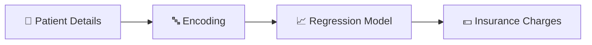

<div align="center">


<b><i>Predict medical insurance charges with ML</i></b>


     

   
</div>

---

## 🏥 About the Project

A **health-care pricing** project that predicts **medical insurance charges** from age, sex, BMI, number of children, smoking status and region using a regression model trained on the popular `insurance.csv` dataset — served through a simple Flask web form.

## ✨ Key Features

- 🧮 Inputs: age, sex, BMI, children, smoker, region
- 🔤 Encoders for sex, smoker and region
- 📈 Regression model with EDA in `health care pricing.ipynb`
- 💵 Instant **predicted charge** on the result page

## 🧠 How It Works



## 🛠️ Tech Stack

| Layer | Technology |
|---|---|
| Language | Python 3 |
| Data & ML | Pandas · NumPy · scikit-learn |
| Notebook | Jupyter |
| Web App | Flask + Jinja2 templates |
| Frontend | HTML5 · CSS3 |

## 📂 Project Structure

```text
HEALTH-CARE-PREDICTION/
├── app.py
├── health care pricing.ipynb
├── insurance.csv
├── model.pkl · le_sex.pkl · le_smoker.pkl · le_region.pkl
└── templates/ (index.html, result.html)
```

## 🚀 Getting Started

```bash
git clone https://github.com/PreciousBharath/HEALTH-CARE-PREDICTION.git
cd HEALTH-CARE-PREDICTION
pip install flask pandas numpy scikit-learn
python app.py
```

## 🤝 Contributing

Contributions, issues and feature requests are welcome! Feel free to ⭐ star the repo and open a pull request.

## 👨‍💻 Author

<div align="center">

**Bharath** — Software Developer · Project Engineer · Technical Trainer

<a href="https://github.com/PreciousBharath"></a>
<a href="https://linkedin.com/in/connectbharath"></a>

### 🍔 EAT · 💻 CODE · 😴 SLEEP · 🔁 REPEAT

⭐ **If you found this project useful, give it a star!** ⭐


</div>
